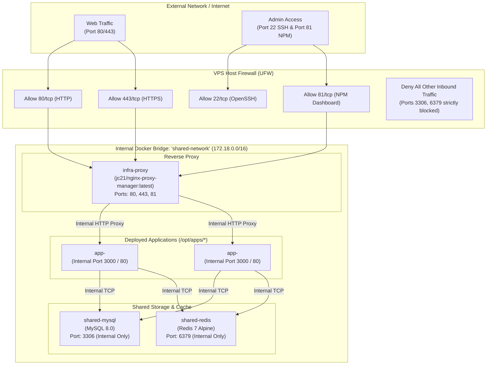

# VPS Server Specification & Infrastructure Architecture

**Server IPv4:** `172.255.210.203`  
**Server IPv6:** `2402:a7c0:3003:115:1c00:c1ff:fe00:d6b`  
**SSH Alias:** `vps-prod`  
**Document Generated:** November 2026  

---

## 1. Hardware & System Specifications

| Component | Specification | Details / Current Status |
| :--- | :--- | :--- |
| **Provider / Hypervisor** | CloudStack KVM | Full KVM Hardware Virtualization |
| **Operating System** | Ubuntu 24.04.5 LTS (Noble Numbat) | 64-bit (`x86_64`) |
| **Kernel** | Linux `6.8.0-146-generic` | SMP PREEMPT_DYNAMIC |
| **CPU Model** | AMD EPYC Processor | Virtualized 6 Cores @ 2.0 GHz, 1 Socket |
| **CPU Threads & Cache** | 6 Cores / 6 Threads | L1d: 192 KiB, L1i: 384 KiB, L2: 3 MiB, L3: 8 MiB |
| **System Memory (RAM)** | **16 GB** (15 GiB Usable / 16,376,316 kB) | ~1.0 GiB Used, ~14 GiB Available |
| **Swap Space** | **4.0 GB** (`/swapfile`) | 0 B Used, 4.0 GiB Available |
| **Primary Storage** | **200 GB SSD** (`/dev/sda2`, ext4) | Total: 197 GB, Used: 9.8 GB (6%), Avail: 179 GB |
| **Primary Network Interface** | `eth0` | `172.255.210.203/24` (Gateway: `172.255.210.254`) |
| **Docker Engine** | Version `29.9.2` (build `a82e528`) | Logging: `json-file` (10m max, 3 files) |
| **Docker Compose** | Version `v5.7.0` | Plugin / Native v2 CLI |

---

## 2. Infrastructure Architecture & Topology



---

## 3. Directory Layout Standard (`/opt`)

All system infrastructure, services, projects, and automated operations reside under `/opt`:

```
/opt/
├── infra/
│   ├── proxy/                      # Nginx Proxy Manager Stack
│   │   ├── docker-compose.yml
│   │   ├── data/                   # NPM configuration, SQLite DB, access lists
│   │   └── letsencrypt/            # SSL certificates & renewal credentials
│   │
│   └── database/                   # Shared MySQL & Redis Stack
│       ├── .env                    # Root credentials (chmod 600)
│       ├── docker-compose.yml
│       ├── data/                   # Persistent MySQL data (/var/lib/mysql, chmod 700)
│       └── init/                   # Custom init SQL scripts (/docker-entrypoint-initdb.d)
│
├── apps/                           # Application Deployments
│   └── <project-slug>/             # Isolated stack per project
│       ├── docker-compose.yml      # Service definition (attaches to shared-network)
│       ├── .env.production         # Project environment variables
│       └── app/                    # Source code, Dockerfile, build artifacts
│
└── ops/                            # Automation, Backups & Maintenance
    ├── backups/                    # chmod 700
    │   ├── db-backup.sh            # Daily automated mysqldump script
    │   └── archives/               # 7-day rolling .sql.gz archives
    └── maintenance/
        └── docker-cleanup.sh       # Weekly Docker builder & image pruning script
```

---

## 4. Active Containers & Services

| Container Name | Base Image | Internal Port | Host Port | Restart Policy | Mounts / Storage |
| :--- | :--- | :--- | :--- | :--- | :--- |
| **`infra-proxy`** | `jc21/nginx-proxy-manager:latest` | `80`, `443`, `81` | `0.0.0.0:80`, `0.0.0.0:443`, `0.0.0.0:81` | `unless-stopped` | `/opt/infra/proxy/data`<br>`/opt/infra/proxy/letsencrypt` |
| **`shared-mysql`** | `mysql:8.0` | `3306`, `33060` | **None** (internal bridge only) | `unless-stopped` | `/opt/infra/database/data` -> `/var/lib/mysql`<br>`/opt/infra/database/init` -> `/docker-entrypoint-initdb.d` |
| **`shared-redis`** | `redis:7-alpine` | `6379` | **None** (internal bridge only) | `unless-stopped` | Redis Append-Only File (AOF) enabled with password protection |

---

## 5. Security & Access Protocols

### 5.1 Host & Network Hardening
1. **Firewall (UFW)**: Default policy is `deny incoming`, `allow outgoing`.
   - Allowed inbound: `22/tcp` (OpenSSH), `80/tcp` (HTTP), `443/tcp` (HTTPS), `81/tcp` (NPM Dashboard).
   - MySQL (`3306`) and Redis (`6379`) are completely blocked from the public interface.
2. **SSH Authentication**: Passwordless `ed25519` key-pair installed in `/root/.ssh/authorized_keys`. Local SSH alias `vps-prod` configured in `~/.ssh/config`.
3. **Credentials Storage**:
   - Stored in `/opt/infra/database/.env` with `0600` permissions (`-rw------- root root`).
   - Applications must never connect using MySQL `root`.

### 5.2 Nginx Proxy Manager Access
- **URL**: `http://172.255.210.203:81`
- **Initial Login**: `admin@example.com` / `changeme`
- **SSL Provisioning**: Free Let's Encrypt certificates managed automatically through the NPM web console with HTTP-01 or DNS-01 challenges.

---

## 6. Automated Operations & Cron Schedules

Configured in `crontab`:

```bash
# Daily full database backup with 7-day retention (Runs at 02:00 AM UTC)
0 2 * * * /opt/ops/backups/db-backup.sh

# Weekly Docker image and build-cache cleanup (Runs Sunday at 04:00 AM UTC)
0 4 * * 0 /opt/ops/maintenance/docker-cleanup.sh
```

### Backup Script Logic (`/opt/ops/backups/db-backup.sh`)
- Uses `mysqldump` with `--single-transaction --quick --lock-tables=false`.
- Compresses directly to gzip: `/opt/ops/backups/archives/all_db_<YYYYMMDD_HHMMSS>.sql.gz`.
- Auto-deletes archives older than 7 days (`find ... -mtime +7 -delete`).

### Maintenance Script Logic (`/opt/ops/maintenance/docker-cleanup.sh`)
- `docker image prune -af --filter "until=168h"` (cleans untagged and unused images older than 7 days).
- `docker builder prune -af --filter "until=168h"` (cleans build cache older than 7 days).

---

## 7. Standard Operating Procedure (SOP) for App Deployments

### Step 1: Provision Isolated Database
Run from this repository:
```bash
./scripts/provision-db.sh <project-slug>
```
Or execute remotely:
```bash
ssh vps-prod 'bash -s' << 'ENDSSH'
source /opt/infra/database/.env
APP_DB="db_<project-slug>"
APP_USER="user_<project-slug>"
APP_PASS=$(openssl rand -base64 18 | tr -dc 'a-zA-Z0-9' | head -c 16)

docker exec -i shared-mysql mysql -u root -p"$MYSQL_ROOT_PASSWORD" <<SQL
CREATE DATABASE IF NOT EXISTS \`${APP_DB}\` CHARACTER SET utf8mb4 COLLATE utf8mb4_unicode_ci;
CREATE USER IF NOT EXISTS '${APP_USER}'@'%' IDENTIFIED BY '${APP_PASS}';
GRANT ALL PRIVILEGES ON \`${APP_DB}\`.* TO '${APP_USER}'@'%';
FLUSH PRIVILEGES;
SQL

echo "DB_HOST=shared-mysql"
echo "DB_PORT=3306"
echo "DB_DATABASE=${APP_DB}"
echo "DB_USERNAME=${APP_USER}"
echo "DB_PASSWORD=${APP_PASS}"
ENDSSH
```

### Step 2: Configure Application Docker Compose
Create `/opt/apps/<project-slug>/docker-compose.yml`:
```yaml
services:
  app:
    build:
      context: ./app
      dockerfile: Dockerfile
    container_name: app-<project-slug>
    restart: unless-stopped
    env_file: .env.production
    networks:
      - shared-network
    # IMPORTANT: DO NOT expose host ports (e.g. no "3000:3000")

networks:
  shared-network:
    external: true
```

### Step 3: Route Traffic in Nginx Proxy Manager
1. Open `http://172.255.210.203:81`.
2. Navigate to **Hosts** -> **Proxy Hosts** -> **Add Proxy Host**.
3. Set **Domain Names**: e.g., `app.yourdomain.com`.
4. Set **Forward Hostname / IP**: `app-<project-slug>` *(resolves automatically via Docker DNS)*.
5. Set **Forward Port**: `3000` (or `80` depending on the framework).
6. Under the **SSL** tab, select **Request a new SSL Certificate**, enable **Block Common Exploits** and **Force SSL**.

