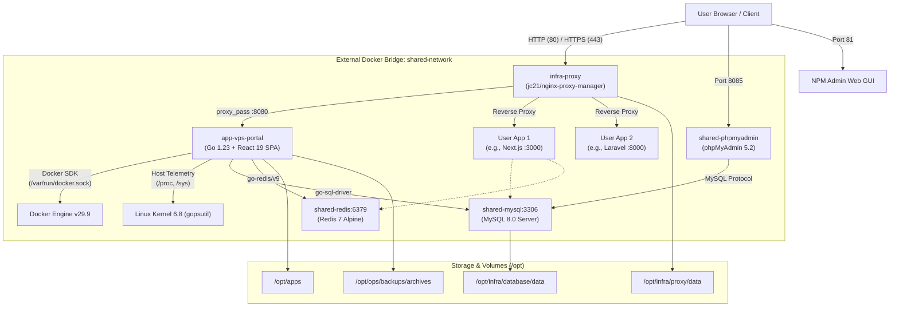

# VPS Nexus Control Portal — Software Architecture & Operational Guide
**Host Target:** `172.255.210.203` (`vps.pixandco.lk`) &bull; **Datacenter:** Singapore 🇸🇬 (LeaseWeb Asia Pacific AS59253) &bull; **Edition:** Black & Charm Red Cybernetic UI

---

## 1. Quick Access Hub & Credentials Directory

All core administrative interfaces are containerized, isolated, and connected through the external Docker bridge network `shared-network`.

| Service | Access URL | Port / Protocol | Default Credentials | Purpose |
| :--- | :--- | :--- | :--- | :--- |
| **VPS Nexus Control Portal** | [http://172.255.210.203](http://172.255.210.203)<br>`https://vps.pixandco.lk` | `80` (HTTP)<br>`443` (HTTPS) | **User:** `admin`<br>**Password:** `[Configured in .env.production]` | Unified host telemetry, Docker orchestrator, DB studio, domain router, ops |
| **phpMyAdmin Web Studio** | [http://172.255.210.203:8085](http://172.255.210.203:8085) | `8085` (HTTP) | **Server:** `shared-mysql`<br>**User:** `root`<br>**Password:** `[Configured in /opt/infra/database/.env]` | Visual web database manager, table browser, SQL query runner |
| **Nginx Proxy Manager (NPM)**| [http://172.255.210.203:81](http://172.255.210.203:81) | `81` (HTTP Admin) | **Email:** `admin@example.com`<br>**Password:** `[Default changeme / user configured]` | Reverse proxy host manager, Let's Encrypt SSL certificates, access lists |
| **Shared MySQL 8.0 (Internal)**| `shared-mysql:3306` | `3306` (Internal Only) | **User:** `root`<br>**Password:** `[Configured in /opt/infra/database/.env]` | High-performance multi-tenant database engine |
| **Shared Redis 7 (Internal)** | `shared-redis:6379` | `6379` (Internal Only) | **Password:** `[Configured in /opt/infra/database/.env]` | In-memory key-value cache, session store, AOF persistence |
| **Direct SSH Access** | `ssh root@172.255.210.203`<br>`ssh vps-prod` | `22` (OpenSSH) | SSH Key / Root Password | Host OS administration, root shell, emergency maintenance |

> [!IMPORTANT]
> Database ports (`3306`, `6379`) are **never** exposed on `0.0.0.0`. They communicate strictly inside `shared-network`. phpMyAdmin connects to `shared-mysql:3306` over the private Docker bridge.

---

## 2. Server Specification & Geolocation

- **Geolocation:** Singapore 🇸🇬 (`1.27998° N, 103.842° E`)
- **Carrier / ISP:** LeaseWeb Singapore Pte. Ltd.
- **Autonomous System (ASN):** `AS59253 LEASEWEB SINGAPORE PTE. LTD.`
- **Timezone:** `Asia/Singapore` (`UTC+8`)
- **CPU:** 6 vCPUs AMD EPYC @ 2.00 GHz
- **Memory (RAM):** 16 GB Physical (15.5 GiB usable) + **4 GB Dedicated Swapfile** (`/swapfile`)
- **Storage:** 200 GB High-Speed SSD (`ext4`, `/` root partition, 6% utilized)
- **Host OS:** Ubuntu 24.04.5 LTS (Noble Numbat), Linux Kernel `6.8.0-146-generic`
- **Container Runtime:** Docker Engine v29.9.3 & Docker Compose v2.32.4
- **Security:** UFW Firewall active (ports `22`, `80`, `443`, `81`, `8085` allowed)

---

## 3. Domain & SSL Setup (`vps.pixandco.lk`)

The VPS is configured with Nginx Proxy Manager to accept traffic for `vps.pixandco.lk`.

### 3.1 DNS Configuration Requirement
To activate SSL via Let's Encrypt, the domain's DNS A-Record must point to the VPS IP:
- **Record Type:** `A`
- **Host / Name:** `vps` (or `vps.pixandco.lk`)
- **Points to (Value):** `172.255.210.203`
- **TTL:** `300` seconds (or default 14400)

### 3.2 Automated SSL Issuance Playbook
Once the DNS record propagates (verify with `dig +short vps.pixandco.lk`), run the pre-configured 1-click issuance script on the VPS:

```bash
ssh vps-prod '/opt/ops/maintenance/issue-ssl.sh'
```

**What this script does:**
1. Verifies that `vps.pixandco.lk` resolves to `172.255.210.203` via public DNS (`8.8.8.8`).
2. Invokes Certbot inside `infra-proxy` over webroot challenge (`/data/letsencrypt-acme-challenge`).
3. Updates `/opt/infra/proxy/data/nginx/proxy_host/vps_portal.conf` with TLS v1.2/1.3, modern ciphers, and automatic HTTP-to-HTTPS 301 redirection.
4. Reloads Nginx gracefully without downtime.

---

## 4. Software Architecture & Structure

```
/opt
├── apps/                         # Application stacks
│   └── vps-portal/               # VPS Nexus Portal stack
│       ├── Dockerfile            # Multi-stage build (Node 20 -> Go 1.23 -> Alpine 3.20)
│       ├── docker-compose.yml    # App container definition (shared-network)
│       ├── .env.production       # Production configuration & secrets
│       ├── backend/              # Go chi server source code
│       │   ├── main.go           # HTTP router & embedded SPA server
│       │   ├── internal/
│       │   │   ├── auth/         # JWT HttpOnly authentication & bcrypt
│       │   │   ├── database/     # MySQL & Redis client drivers
│       │   │   ├── docker/       # Official Docker Go SDK integration
│       │   │   ├── ops/          # Backup executor & Docker prune runner
│       │   │   ├── proxy/        # NPM SQLite route reader
│       │   │   └── telemetry/    # gopsutil metrics collector & geolocation
│       └── frontend/             # React 19 + TypeScript frontend
│           ├── src/
│           │   ├── App.tsx       # Main tabbed control surface
│           │   ├── components/   # Symmetrical UI component modules
│           │   │   ├── auth/     # Obsidian & Charm Red login card
│           │   │   ├── layout/   # TopHeader, AppSidebar, CommandPalette
│           │   │   ├── telemetry/# MetricKpiCard, CoreInfraStrip, ServerGeoCard
│           │   │   ├── database/ # DbTable, RedisStatusCard, PhpMyAdminCard
│           │   │   ├── containers/# ContainerTable, LogStreamSheet, EnvEditor
│           │   │   ├── proxy/    # ProxyTable, AddDomainDialog
│           │   │   └── ops/      # BackupArchiveTable, DockerPruneCard
│           │   ├── hooks/        # useTelemetrySSE with real-time ping RTT
│           │   └── index.css     # Pitch Black & Charm Red design tokens
├── infra/                        # Core Infrastructure stacks
│   ├── database/                 # MySQL 8.0, Redis 7 & phpMyAdmin
│   │   ├── docker-compose.yml
│   │   ├── .env                  # Master passwords
│   │   └── data/                 # Persistent MySQL database files
│   └── proxy/                    # Nginx Proxy Manager
│       ├── docker-compose.yml
│       └── data/                 # SQLite database, Nginx vhosts, ACME tokens
└── ops/                          # Automation & Maintenance scripts
    ├── backups/
    │   ├── db-backup.sh          # Nightly mysqldump execution script
    │   └── archives/             # 7-day rolling .sql.gz archives
    └── maintenance/
        ├── docker-cleanup.sh     # Weekly prune script
        └── issue-ssl.sh          # Let's Encrypt automated issuance
```

---

## 5. Architectural Flow & Container Topology



---

## 6. Symmetrical UI/UX Design System ("Black & Charm Red")

The VPS Nexus interface is engineered for zero visual fatigue with high-contrast cybernetic elegance:
1. **Background Hierarchy:** Deepest obsidian pitch black canvas (`#050508`), translucent glassmorphism cards (`bg-zinc-950/80` with `backdrop-blur-xl`).
2. **Charm Red Accent Palette:**
   - **Primary Charm Red:** `#e11d48` (Rose-600) & `#f43f5e` (Rose-500)
   - **Glow Accents:** `shadow-[0_0_20px_rgba(225,29,72,0.25)]` and `border-rose-500/30`
   - **Gradients:** `bg-gradient-to-r from-rose-600 via-rose-500 to-red-600`
3. **Symmetrical Geometry:**
   - 4-Card System KPI Grid (CPU, RAM+Swap, Storage, Docker Network)
   - 4-Card Core Infrastructure Grid (Nginx Proxy Manager, MySQL 8, Redis 7, phpMyAdmin)
   - Balanced 2-column drawer layout for live container logs and `.env` editing
4. **Real-time Latency Radar:**
   - Ping RTT calculated via `/api/v1/ping` every 3 seconds.
   - Dynamic status dot: Green `< 70ms`, Amber `70-160ms`, Crimson `> 160ms`.

---

## 7. Complete REST API Reference

All endpoints (except `/auth/login`, `/ping`, `/meta`) require the `jwt_token` cookie or `Authorization: Bearer <token>` header.

### 7.1 Authentication & System Meta
- `POST /api/v1/auth/login` — Authenticate with username and password. Issues `HttpOnly`, `SameSite=Strict` cookie.
- `POST /api/v1/auth/logout` — Revokes session and clears cookie.
- `GET /api/v1/auth/me` — Returns current authenticated user and session validity.
- `GET /api/v1/ping` — Lightweight latency probe returning `{ status: "pong", t: <epoch_ms> }`.
- `GET /api/v1/meta` — Returns server IP, domain, geolocation metadata, and web console URLs.

### 7.2 Telemetry & Real-Time Monitoring
- `GET /api/v1/telemetry/stream` — Server-Sent Events (SSE) stream pushing full host telemetry every 2 seconds:
  - CPU usage percent, core counts, 1m/5m/15m load averages.
  - RAM total, used, free, and percentage.
  - 4GB Swapfile utilization and byte counts.
  - Root (`/`) and `/opt` disk capacity and utilization.
  - Docker container counts and network health.
  - Geolocation (Singapore, LeaseWeb DC, timezone, coordinates).

### 7.3 Containers & Application Orchestration
- `GET /api/v1/containers` — List all Docker containers with live CPU %, RAM bytes, ports, and state.
- `POST /api/v1/containers/{id}/{action}` — Trigger `start`, `stop`, or `restart` on any container.
- `GET /api/v1/containers/{id}/logs?tail=200` — Retrieve the latest 200 lines of standard output and error.
- `GET /api/v1/apps/{slug}/env` — Read `/opt/apps/<slug>/.env.production`.
- `PUT /api/v1/apps/{slug}/env` — Write and update `/opt/apps/<slug>/.env.production`.
- `POST /api/v1/apps/scaffold` — Scaffold a new app folder with boilerplate `docker-compose.yml`, `Dockerfile`, and `.env.production`.

### 7.4 Databases & phpMyAdmin
- `GET /api/v1/databases` — List MySQL user databases with table counts and disk size in MB.
- `POST /api/v1/databases` — Provision a new MySQL database and isolated user with permissions.
- `POST /api/v1/databases/{name}/dump` — Export an on-demand compressed SQL dump.
- `GET /api/v1/redis/stats` — Retrieve Redis memory usage, connected clients, key count, and uptime.
- `POST /api/v1/redis/flush` — Flush Redis DB cache.

### 7.5 Domains & Reverse Proxy
- `GET /api/v1/proxy/hosts` — Inspect active Nginx Proxy Manager domain routes.
- `POST /api/v1/proxy/hosts` — Register a new proxy host routing to internal container ports.

### 7.6 Operations & Backups
- `GET /api/v1/ops/backups` — List all `.sql.gz` backup archives in `/opt/ops/backups/archives`.
- `POST /api/v1/ops/backups/run` — Trigger `/opt/ops/backups/db-backup.sh` immediately.
- `GET /api/v1/ops/backups/download/{filename}` — Securely stream download an archive.
- `POST /api/v1/ops/prune` — Execute `docker system prune -af` to reclaim disk space.

---

## 8. Operations & Maintenance Playbook

### 8.1 Automated Cron Schedules
1. **Daily Database Backup:** Runs every morning at `02:00 UTC`.
   - Script: `/opt/ops/backups/db-backup.sh`
   - Keeps 7 rolling daily archives in `/opt/ops/backups/archives/`.
2. **Weekly Docker Cleanup:** Runs every Sunday at `04:00 UTC`.
   - Script: `/opt/ops/maintenance/docker-cleanup.sh`
   - Purges dangling images, unused build caches, and stopped temporary containers.

### 8.2 Deploying a New Application Stack
1. Create application folder: `mkdir -p /opt/apps/<project-slug>/app`
2. Create `docker-compose.yml`:
   ```yaml
   services:
     web:
       build: .
       container_name: app-<project-slug>
       restart: unless-stopped
       env_file: .env.production
       networks:
         - shared-network

   networks:
     shared-network:
       external: true
   ```
3. Start the stack: `docker compose up -d`
4. Route domain in VPS Nexus (**Domains & Proxy**) or in NPM to `app-<project-slug>:<port>`.